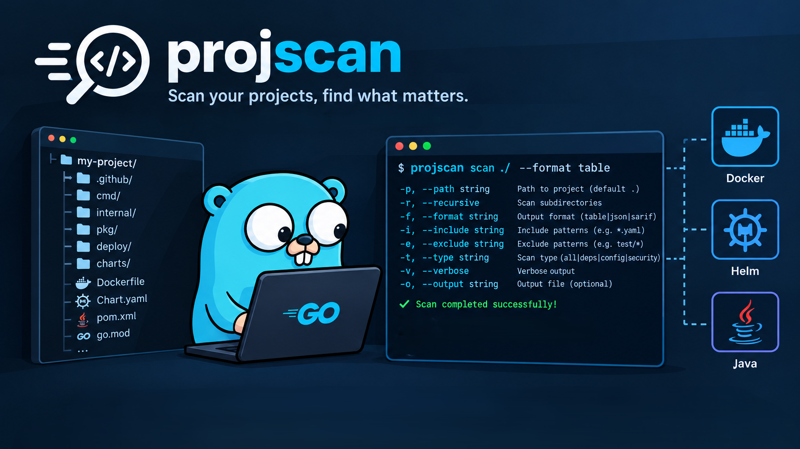

# ProjScan



ProjScan is a Go-based CLI tool for scanning a directory and identifying software artifacts such as Docker image archives, Helm charts, Java application bundles, and release directories. It inspects each artifact, extracts metadata, and writes a structured JSON inventory for downstream automation, validation, and reporting.

The project is designed for teams that manage curated artifact repositories, release staging environments, and package inventories where it is useful to quickly answer questions like:

- What artifacts exist in this directory?
- Which Docker images and Helm charts are present?
- Are there multiple versions of the same artifact?
- Can I keep only the latest versions?

## Features

- Scans directories recursively for supported artifact types
- Detects and inventories:
  - Docker image archives (`.tar`, `.tar.gz`, `.tgz`)
  - Helm charts (`Chart.yaml` directories and packaged chart archives)
  - Java application archives
  - Release directories matching common versioned patterns
- Extracts useful metadata such as:
  - chart name, version, appVersion, and description
  - Docker image tags and config/layer references
  - Java archive application names and semantic versions
- Writes results to `results.json` in the target directory
- Supports filtering to the latest artifact versions only via `--latest`
- Provides both CLI flags and environment variable configuration

## Supported Artifact Types

### Docker image archives

ProjScan detects OCI/Docker image archives by reading `manifest.json` and validating referenced config/layer blobs. It captures:

- image tags
- config and layer references
- file inventory inside the archive

### Helm charts

ProjScan inspects Helm chart directories or packaged chart archives and extracts metadata from `Chart.yaml`, including:

- `name`
- `version`
- `appVersion`
- `type`
- `description`

### Java application archives

The scanner recognizes Java artifacts by naming convention and build metadata, then extracts version information and identifies whether the archive appears to contain a Java application.

### Release directories

Release directories following a versioned naming pattern are collected and optionally reduced to only the newest release when using the latest-only mode.

## Installation

Requirements:

- Go 1.27 or later

Install the CLI:

```bash
go install github.com/afshinnkarimi/projscan/cmd/projscan@latest
```

You can then run it from your shell:

```bash
projscan --directory /path/to/artifacts
```

## Usage

### Basic scan

```bash
projscan --directory ./artifacts
```

This scans the provided directory and creates `results.json` in that directory.

### Keep only latest versions

```bash
projscan --directory ./artifacts --latest
```

This removes older duplicate versions for Docker tags, Helm charts, and Java archive families while retaining the newest version per artifact group.

### Directory alias

```bash
projscan --dir ./artifacts
```

### Environment variable configuration

```bash
export PROJSCAN_DIRECTORY=/path/to/artifacts
projscan
```

## Example Output

The tool emits a JSON array of scan results, for example:

```json
[
  {
    "name": "busybox:1.36.1",
    "path": "/artifacts/busybox.tar.gz",
    "type": "docker-image",
    "inventory": {
      "files": [
        "blobs/sha256/...",
        "index.json",
        "manifest.json"
      ],
      "image": {
        "config": ["blobs/sha256/..."],
        "tags": ["busybox:1.36.1"],
        "layers": ["blobs/sha256/..."]
      }
    }
  },
  {
    "name": "seaweedfs",
    "path": "/artifacts/seaweedfs-4.48.0.tgz",
    "type": "helm-chart",
    "inventory": {
      "metadata": {
        "name": "seaweedfs",
        "version": "4.48.0",
        "appVersion": "4.48"
      }
    }
  }
]
```

## Project Structure

```text
.
├── cmd/
│   └── projscan/            # CLI entry point
├── internal/
│   ├── app/                 # scan orchestration
│   ├── releases/            # release directory detection
│   └── scanner/             # artifact scanners and metadata extraction
├── go.mod                   # Go module definition
├── go.sum
├── results.json              # generated output example
└── README.md
```

## Development

```bash
go test ./...
```

This runs the repository test suite to validate scan behavior and CLI options.

## Notes

ProjScan is a lightweight, automation-friendly inventory tool intended for structured artifact discovery. It is especially useful in repository management workflows, release pipelines, and internal platforms that need a consistent inventory of packaged software assets.
